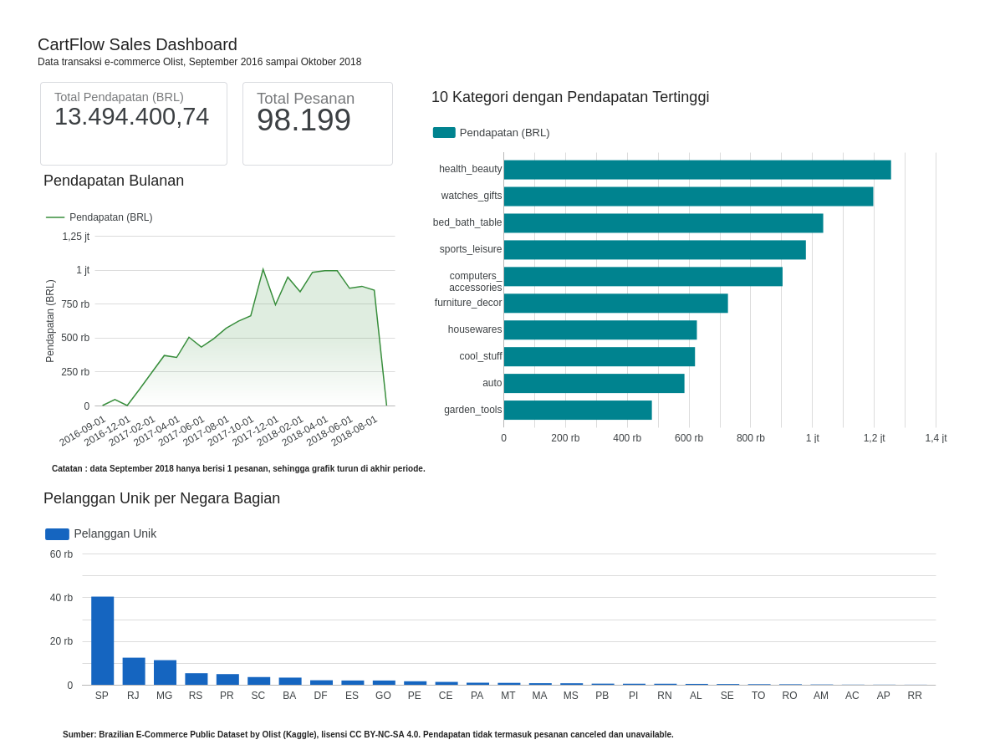
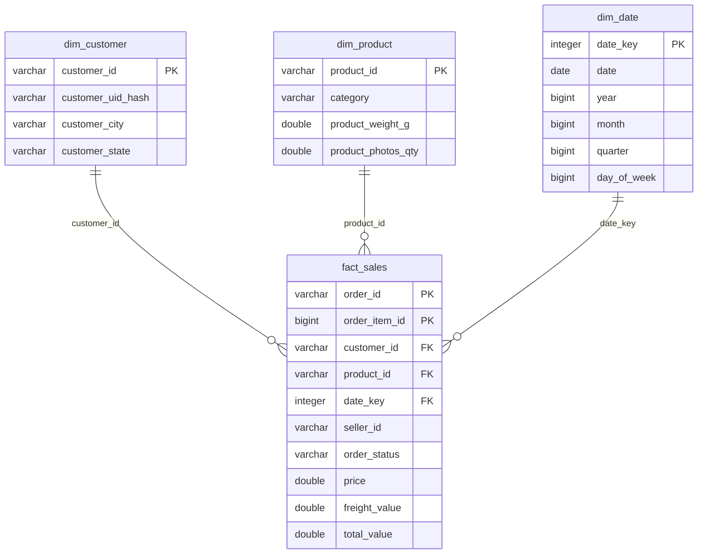

# CartFlow

Pipeline ETL sederhana yang mengolah data transaksi e-commerce [Olist (Brasil) dari Kaggle](https://www.kaggle.com/datasets/olistbr/brazilian-ecommerce) menjadi data warehouse berbentuk star schema di DuckDB. Pipeline mencakup pembersihan data, pseudonimisasi data pelanggan, pengecekan kualitas data, penjadwalan otomatis dengan GitHub Actions, serta ekspor mart ringkas untuk dashboard.

## Hasil

Satu kali eksekusi pipeline pada dataset lengkap menghasilkan:

| Tabel | Jumlah baris |
|---|---|
| fact_sales | 112.650 |
| dim_customer | 99.441 |
| dim_product | 32.951 |
| dim_date | 774 |

Data mencakup pesanan dari 4 September 2016 sampai 17 Oktober 2018. Seluruh 8 pengecekan kualitas data lolos.

Hasil mart divisualisasikan dalam [dashboard Data Studio](https://datastudio.google.com/reporting/10aa5153-7945-4415-8ef6-1d0872d7c61b). Total pendapatan di luar pesanan yang dibatalkan dan tidak tersedia adalah BRL 13.494.400,74 dari 98.199 pesanan. Kategori dengan pendapatan tertinggi adalah health_beauty, dan negara bagian São Paulo (SP) memiliki pelanggan unik terbanyak.



## Arsitektur

```
CSV Kaggle  >  extract  >  transform (pandas)  >  load (DuckDB)  >  cek kualitas  >  ekspor CSV mart
```

1. Extract mengunduh dataset dari Kaggle dan menyalin lima tabel yang dipakai ke `data/raw/`.
2. Transform membersihkan tiap tabel dengan pandas.
3. Load memuat hasil transform ke tabel staging (`stg_*`), lalu membangun star schema dengan SQL di `sql/star_schema.sql`.
4. Cek kualitas menjalankan query validasi. Jika ada yang gagal, pipeline berhenti dengan kode keluar 1 dan mart tidak diekspor.
5. Mart diekspor ke `data/export/` dalam format CSV untuk diunggah ke Data Studio.

## Skema data warehouse

Grain tabel fakta adalah satu baris per item dalam pesanan.



Penjelasan setiap kolom tersedia di [docs/data_dictionary.md](docs/data_dictionary.md).

| Tabel | Kunci | Isi |
|---|---|---|
| fact_sales | order_id, order_item_id | customer_id, product_id, seller_id, date_key, order_status, price, freight_value, total_value |
| dim_customer | customer_id | customer_uid_hash, customer_city, customer_state |
| dim_product | product_id | category, product_weight_g, product_photos_qty |
| dim_date | date_key (YYYYMMDD) | date, year, month, quarter, day_of_week |

Tiga view mart dibangun di atas skema tersebut: `mart_sales_monthly` (jumlah pesanan dan pendapatan per bulan), `mart_top_categories` (pendapatan per kategori), dan `mart_customers_by_state` (jumlah pelanggan unik per negara bagian). Pesanan berstatus `canceled` dan `unavailable` tidak dihitung dalam mart penjualan.

## Pembersihan data

Masalah yang ditemukan saat profiling data mentah dan cara penanganannya:

- Kolom tanggal tersimpan sebagai teks, sehingga dikonversi ke datetime. Nilai kosong pada tanggal persetujuan dan pengiriman dibiarkan null karena menandakan pesanan belum sampai tahap tersebut.
- Nama kategori produk berbahasa Portugis, sehingga diterjemahkan ke bahasa Inggris memakai tabel terjemahan resmi dari dataset.
- Sebanyak 623 produk tidak memiliki kategori yang dapat diterjemahkan. Sebanyak 610 di antaranya memang tidak memiliki kategori, sedangkan 13 sisanya memakai dua kategori yang tidak tercantum di tabel terjemahan (`portateis_cozinha_e_preparadores_de_alimentos` dan `pc_gamer`). Semuanya diberi kategori `unknown`.
- Penulisan kota dan negara bagian diseragamkan (spasi dibuang, huruf kapital diseragamkan).
- Duplikat dibuang berdasarkan kunci tiap tabel.

## Perlindungan data pribadi

Kolom `customer_unique_id` merupakan pengenal pelanggan lintas pesanan. Kolom ini tidak dibawa ke warehouse dan diganti dengan `customer_uid_hash`, yaitu hash SHA-256 bersalt yang dipotong 16 karakter. Hash tetap konsisten untuk pelanggan yang sama sehingga analisis pelanggan unik masih bisa dilakukan (96.096 pelanggan unik dari 99.441 customer_id), tetapi ID aslinya tidak dapat dibaca langsung dari warehouse. Kode pos juga tidak dibawa karena tidak dibutuhkan untuk analisis.

Salt dibaca dari variabel lingkungan `PII_SALT` dan disimpan sebagai GitHub Secret. Pendekatan ini mengikuti prinsip minimisasi dan pseudonimisasi data pribadi seperti diatur dalam UU No. 27 Tahun 2022 tentang Pelindungan Data Pribadi.

## Pengecekan kualitas data

Setiap cek adalah query SQL yang menghitung jumlah baris bermasalah. Hasilnya dicatat ke `data/quality_log.csv` beserta waktu eksekusi.

- Harga harus lebih dari nol dan ongkos kirim tidak boleh negatif.
- Tidak ada item pesanan yang duplikat.
- Setiap baris fakta harus memiliki pasangan di dim_date, dim_customer, dan dim_product.
- customer_id di dim_customer tidak boleh null.
- dim_customer tidak boleh memuat kolom ID pelanggan asli.

## Penjadwalan

Workflow `.github/workflows/pipeline.yml` menjalankan pipeline setiap hari pukul 08.00 WIB dan dapat dijalankan manual. Hasil ekspor dan log kualitas diunggah sebagai artifact. Workflow `ci.yml` menjalankan lint dan test pada setiap push dan pull request memakai data contoh kecil sehingga tidak membutuhkan akun Kaggle.

Secret yang dibutuhkan adalah `PII_SALT`. Dataset bersifat publik sehingga dapat diunduh tanpa autentikasi; `KAGGLE_USERNAME` dan `KAGGLE_KEY` bersifat opsional.

Setiap eksekusi di GitHub Actions menulis ringkasan operasional ke halaman run, berisi jumlah baris per tabel dan hasil cek kualitas. Langkah penanganan jika pipeline gagal tercantum di [docs/runbook.md](docs/runbook.md), dan riwayat perubahan dicatat di [CHANGELOG.md](CHANGELOG.md).

## Batasan

- Dataset Olist bersifat statis (tidak bertambah), sehingga eksekusi terjadwal menghasilkan data yang sama. Penjadwalan ditujukan untuk menunjukkan alur kerja otomatis.
- Pipeline memuat ulang seluruh data setiap kali dijalankan (full refresh), belum incremental.
- Tabel pembayaran, ulasan, seller, dan geolokasi belum dimasukkan.

## Menjalankan

Membutuhkan Python 3.12 dan [uv](https://docs.astral.sh/uv/). Kredensial Kaggle tidak wajib karena dataset bersifat publik.

```bash
uv sync
uv run python -m pipeline   # menjalankan seluruh pipeline
uv run pytest -q            # menjalankan test
```

## Struktur repositori

```
pipeline/
  extract.py      unduh dataset dan salin ke data/raw
  transform.py    pembersihan dan pseudonimisasi
  load.py         memuat ke DuckDB dan ekspor mart
  quality.py      pengecekan kualitas data
  __main__.py     menjalankan seluruh tahap
sql/
  star_schema.sql definisi star schema dan mart
tests/            test dengan data contoh
docs/
  data_dictionary.md  penjelasan kolom dan klasifikasi data
  runbook.md          penanganan kegagalan pipeline
.github/workflows CI dan pipeline terjadwal
CHANGELOG.md      riwayat perubahan
```

## Sumber data

Olist. *Brazilian E-Commerce Public Dataset by Olist* [Data set]. Kaggle. https://www.kaggle.com/datasets/olistbr/brazilian-ecommerce. Lisensi CC BY-NC-SA 4.0.
